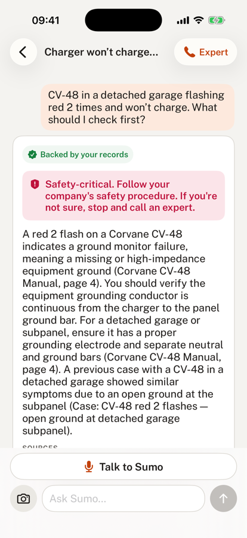
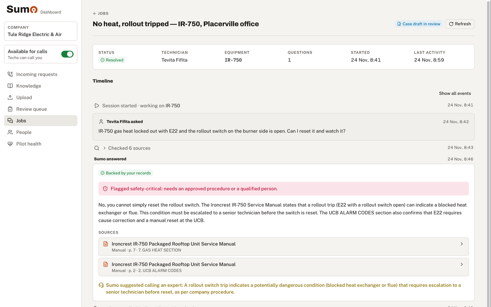

# Sumo

**Every tech a heavyweight.** Sumo puts a shop's best technician in every truck. A field tech
in HVAC or electrical asks a question by text, voice or camera and gets an answer grounded
only in the shop's own approved manuals and past fixes, with the exact page cited. When the AI
can't help, one tap starts a live video call with the shop's expert, and the fix from that call
becomes a reviewed company case that the next tech's answer can cite.

[sumocrew.com](https://sumocrew.com) · iPhone app on TestFlight · source repositories are private

<p align="center">
  
  &nbsp;
  
</p>
<p align="center"><sub>Screenshots use a fictional demo shop.</sub></p>

## What it does

- **Grounded answers, not guesses.** Every answer comes from the shop's approved knowledge,
  cites the page, and says plainly when there is no record, when sources conflict, or when a
  safety caution applies.
- **Hands-free voice and camera.** Techs talk to Sumo with gloves on (Gemini Live) and point
  the rear camera at the unit; photos go with the question.
- **One-tap expert calls.** A live LiveKit video call to an available expert, with a frozen
  hand-off summary, recording only with both people's consent, and a confirmed outcome.
- **Calls become company knowledge.** After a call, Sumo drafts a structured case (symptoms,
  root cause, fix, verification) from the transcript. An expert reviews it, and only then can
  answers cite it.
- **An office that stays in control.** Experts upload manuals (bulk PDF ingest with OCR),
  review what was extracted, and approve exactly what goes live. Admins invite the crew and
  see pilot health as shop totals, never per person.

## Architecture

```
  Technician iPhone app (SwiftUI)          Office dashboard (Next.js)
        │  text / photo / voice                 │  knowledge, review, call queue, cases
        │                                        │
        ├──────── HTTPS + SSE ──────────┬────────┘
        │                               ▼
        │                SumoApi  (FastAPI, Python 3.12, Fly.io)
        │                 ├─ multi-tenant auth: Supabase JWT + per-request org
        │                 ├─ hybrid retrieval: pgvector + Postgres full-text, RRF fusion
        │                 ├─ grounded answers + citation validation (Gemini 2.5 Flash)
        │                 ├─ ingest worker: PDF parse, OCR, chunk, embed (Postgres job queue)
        │                 ├─ expert requests, call state, consent, case drafts (Gemini 2.5 Pro)
        │                 └─ mints every Gemini Live and LiveKit token
        │                               │
        │                   Supabase: Postgres + pgvector, Auth, private Storage
        │
        ├──── Gemini Live WebSocket (voice, single-use token from SumoApi)
        └──── LiveKit room ◄────────────► expert in the dashboard
```

The clients hold no model or LiveKit secrets. SumoApi owns retrieval, generation and every
authorization decision, and scopes every query to one company.

## Repositories

| Repo | What it is | Stack |
|---|---|---|
| **SumoApi** | Backend and AI pipeline: knowledge vault, retrieval, answers, voice tools, expert escalation, case drafting, pilot onboarding | Python 3.12, FastAPI, SQLAlchemy 2 async, Alembic, Postgres + pgvector, Gemini, LiveKit, Fly.io |
| **SumoField-ios** | Technician iPhone app: text, voice and camera questions, citations to the manual page, expert video calls, company cases | Swift 6 (strict concurrency), SwiftUI, LiveKit, Supabase Auth, XcodeGen |
| **SumoDashboard** | Expert and admin web app: uploads, review and approval, live call queue, call room, case editor, people, pilot health | Next.js 16, React 19, TypeScript, Tailwind 4, shadcn/ui, LiveKit, react-pdf, Vercel |
| **SumoWebsite** | Product site at sumocrew.com | Next.js 16, Tailwind 4, Vercel |

## Engineering highlights

- **Retrieval built for trade manuals.** Vector search (768-dim `gemini-embedding-001`, HNSW)
  fused with Postgres full-text search by reciprocal rank fusion. A second, unstemmed `simple`
  text index keeps model numbers and fault codes exact. Only approved, indexed, current
  versions are eligible, in one SQL eligibility filter shared by both search legs.
- **Measured, not vibes.** An answer-quality bench runs on a real-manual gold set of 247
  questions. Latest full run: the right page in the top 5 for 90.6% of questions (97.0% in the
  top 10), 78.5% of answers passing all checks, 99.5% of citations supported by the cited
  text, and 93.2% of safety cautions surfaced, at about $0.004 and 2.7 s (p50) per typed
  question. The honest gap: Sumo admits "no record" on only 51% of the questions it should
  (74% precision), the next thing to improve. A cheaper offline tier gates every pull request.
- **Voice that survives the field.** The app records Gemini Live resumption handles and
  reconnects through fresh server-minted tokens. It hands the audio session cleanly from Sumo
  to a LiveKit expert call and back, with one rear-camera pipeline feeding Gemini, photos and
  the call.
- **Safe by construction.** Approvals are bound to an exact content hash, edits use optimistic
  concurrency (`If-Match`), expert-request creation is idempotent, accepts are atomic, and all
  model or user text renders through safe Markdown with no clickable links.
- **Multi-tenant from the first migration.** Every tenant table carries `org_id`, and tests
  check isolation between companies.
